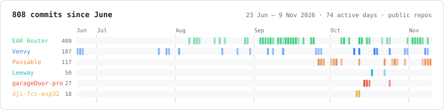

### Nikolaus · Vienna

Most of what I build starts because I need it: a panel to run my own servers, a route planner for my Zivildienst tours, a chartplotter for the boat, and two little boards that save me a few annoying seconds every day. Sometimes it's just curiosity, like teaching a Mac to DJ. It's all open source, and the servers run on a mini PC at home.

**[ringtwo.win](https://ringtwo.win)** has the long version. Every project there has something to play with: break a Venvy deploy, find a Viennese door in the city's register with EAR Router's own rules, sail around rocks, drive a car home through the garage door.

<picture>
  <source media="(prefers-color-scheme: dark)" srcset="activity-dark.svg">
  
</picture>

---

### [Venvy](https://github.com/nikolaus018/venvy)
My own Heroku for one Linux box. It runs Python, Node, Bun, Deno, Go, Rust, PHP, Ruby, Java and static sites, each app as its own Unix user. A git deploy runs a health check and rolls back by itself if the new release doesn't come up. There's also a browser terminal, live logs, backups, and Cloudflare Tunnel publishing. Every site on ringtwo.win runs on it. My favourite, and over a year of work, most of it from before it went public.

<a href="https://github.com/nikolaus018/venvy"></a>

```bash
curl -fsSL https://github.com/nikolaus018/venvy/releases/latest/download/install.sh | sudo bash
```

### [Passable](https://github.com/nikolaus018/passable)
I wanted to know how hard it really is to automate what a DJ does. You drop in songs and it returns one continuous mix. Every song is split into vocals, melody, drums and bass on Core ML (HTDemucs + Mel-Band RoFormer). Then the set is ordered by tempo, key and energy, and each transition is planned stem by stem. Voices hand over between lines, on the singer's breath. **[▶ Listen to transitions from a real set](https://passable.ringtwo.win)**

<a href="https://github.com/nikolaus018/passable"></a>

<table>
<tr>
<td width="50%" valign="top">

### [EAR Router](https://github.com/nikolaus018/ear-router)
The route planner I use on every tour of my Zivildienst with Meals on Wheels in Vienna. Addresses are checked against the city's building register, the stop order comes from a self-hosted OSRM server, and arrival times were backtested on 12 real tours. It works offline, has CarPlay and Siri, and uses no third-party dependencies.

  

</td>
<td width="50%" valign="top">

### [Leeway](https://github.com/nikolaus018/leeway)
A chartplotter for iPhone, because I go boating. It plans routes through water deep enough for the boat, clear of rocks, wrecks and bridges lower than the mast. A weather mode grows isochrones using the boat's own polar. It also has AIS collision alarms, an anchor watch and NMEA instruments. The charts are built from open data and served by a Rust server.

  

</td>
</tr>
<tr>
<td width="50%" valign="top">

### [garageDoor-pro](https://github.com/nikolaus018/garageDoor-pro)
An ESP32-C3 with GPS that opens the garage door when the car leaves and comes home. No phone involved. The state machine is pure C and tested on the host under ASan/UBSan. The 4-layer PCB is generated from a Python netlist.


</td>
<td width="50%" valign="top">

### [dji-fcc-esp32](https://github.com/nikolaus018/dji-fcc-esp32)
A pocket dongle that replaces an Android app. An ESP32-S3, acting as USB host, patches a DJI remote. It ships its own fix to Espressif's USB stack for 512-byte bulk packets, plus a [Web Serial flasher](https://nikolaus018.github.io/dji-fcc-esp32/).


</td>
</tr>
</table>


<sub>The chart is generated from these repos' commit history by <a href="https://github.com/nikolaus018/ringtwo.win/blob/main/tools/activity_svg.py">tools/activity_svg.py</a>.</sub>
